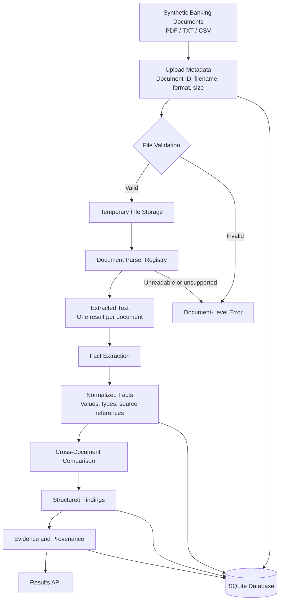
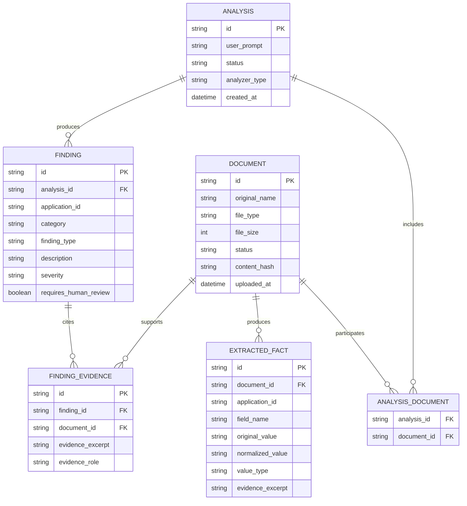

# Data Architecture — BankDoc Intelligence

## 1. Purpose

BankDoc Intelligence reviews synthetic banking documents, extracts supported facts, compares information across documents, and produces findings with traceable evidence.

The application must preserve document boundaries throughout processing. Findings must reference their source documents instead of relying on one merged, untraceable text prompt.

This is a demonstration application, not a credit-decision system.

## 2. Data Processing Architecture

## 3. Data Flow

1. The user selects multiple synthetic documents and provides an analysis instruction.
2. The backend validates file count, size, format, and readability.
3. Each accepted document is processed independently using its appropriate parser.
4. Extracted text remains associated with the document that produced it.
5. Fact extraction identifies fields such as application ID, applicant name, monthly income, obligations, and dates.
6. Normalization converts supported values into consistent representations while retaining original values and source references.
7. Facts are grouped by application ID and compared across corresponding documents.
8. The analyzer produces structured findings.
9. Each finding is checked for valid document references and supporting evidence.
10. Metadata, extracted facts, and analysis results can be persisted in SQLite.

## 4. Logical Data Model

## 5. Main Entities

### Document

Represents an uploaded file. Its ID identifies the source throughout extraction and analysis.

### Analysis

Represents one user-requested analysis, including the instruction, processing status, and analyzer type.

### Analysis Document

Links the documents selected for a particular analysis.

### Extracted Fact

Stores a value extracted from a specific document. The value should retain its type, source document, and supporting text.

### Finding

Represents an extracted fact, calculated value, discrepancy, missing-information result, or interpretation.

### Finding Evidence

Links a finding to one or more supporting documents and evidence excerpts.

## 6. Data Integrity Rules

- Match related documents using a stable application ID where available.
- Never combine unrelated applicants just because their names are similar.
- Preserve the original value alongside any normalized value.
- Use numeric representations for financial calculations.
- Record currency and units explicitly.
- Do not interpret all account credits as salary.
- Distinguish declared obligations from independently verified obligations.
- A missing extracted field does not prove that the source document lacks the information.
- Every discrepancy must cite the documents and values compared.
- Do not generate a fraud accusation or automatic lending decision.

## 7. Storage and Retention

For the time-boxed demo, SQLite stores application metadata and analysis information as supported by the implementation.

Temporary uploads should be cleaned up after processing where possible. Production deployments would require an explicit retention policy, encrypted storage, access control, audit logging, and controlled deletion.

## 8. Assumptions and Limitations

- Only supported document formats are processed.
- Scanned PDFs may require OCR, which is not guaranteed by a text-based PDF parser.
- The mock analyzer uses deterministic rules rather than a live LLM.
- Extraction quality depends on document structure.
- Synthetic test data must not contain real customer or account information.
