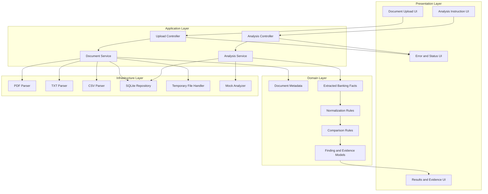

# High-Level Design (HLD) — BankDoc Intelligence

## 1. Objective

The high-level design divides BankDoc Intelligence into presentation, application, domain, and infrastructure responsibilities.

This separation makes document processing testable and helps prevent UI logic, parsing logic, and comparison rules from becoming tightly coupled.

## 2. Layered Architecture

## 3. Module Descriptions

### Upload Module

Responsible for accepting multiple files and enforcing the upload policy.

Inputs:
- Files selected by the user.
- Supported file types.
- Maximum file count and size.

Outputs:
- Document IDs.
- File metadata.
- Validation and processing status.

### Document Processing Module

Responsible for reading each supported format and extracting text.

Inputs:
- Validated file.
- Document ID.
- File format.

Outputs:
- Extracted text.
- Extraction status.
- Error details where processing fails.

### Fact Extraction Module

Responsible for converting extracted text into typed banking facts.

Example fields:
- Application ID.
- Applicant name.
- Declared monthly income.
- Certified monthly salary.
- Existing monthly obligations.
- Transaction date and amount.

Every fact should retain its source document and supporting excerpt when available.

### Normalization Module

Responsible for standardizing values for comparison.

Examples:
- Convert supported currency strings into numeric INR amounts.
- Standardize dates.
- Normalize whitespace in identifiers and names.
- Preserve original values so normalization does not destroy source evidence.

### Comparison Module

Responsible for comparing facts belonging to the same application.

Examples:
- Declared income versus certified salary.
- Applicant name variations.
- Monthly credit totals versus declared income.
- Declared obligations versus observed EMI debits.

A difference is a review signal, not proof of wrongdoing.

### Finding Module

Responsible for producing structured output containing:
- Finding ID.
- Application ID.
- Category.
- Description.
- Finding type.
- Values compared.
- Supporting documents and evidence.
- Human-review requirement.

### Persistence Module

Responsible for storing document metadata, extracted facts, analysis metadata, findings, and source references as supported by the implementation.

## 4. Key Design Decisions

1. React and TypeScript separate presentation from backend processing.
2. Express exposes a simple HTTP API.
3. Dedicated parser modules support multiple document formats.
4. A relational database provides stable identifiers and structured persistence.
5. Deterministic comparison rules make the demo reproducible.
6. Provenance links make results auditable.
7. Errors are represented explicitly instead of being treated as valid empty results.

## 5. Important Quality Attributes

### Traceability

Every discrepancy should point to the values and documents used to derive it.

### Reliability

A parsing failure should be visible and should not silently become an empty document.

### Maintainability

Parsers, comparison rules, API handlers, and UI components should be independently understandable.

### Security

Only synthetic documents are used. Upload validation and temporary-file cleanup reduce risk.

### Testability

Comparison rules and normalization functions should be testable without starting the entire UI.

## 6. Scope Boundaries

The demo does not approve or reject loans, establish fraud, verify identity against external databases, or guarantee the authenticity of submitted documents.

OCR, live LLM integration, authentication, and production deployment are separate enhancements unless implemented.
