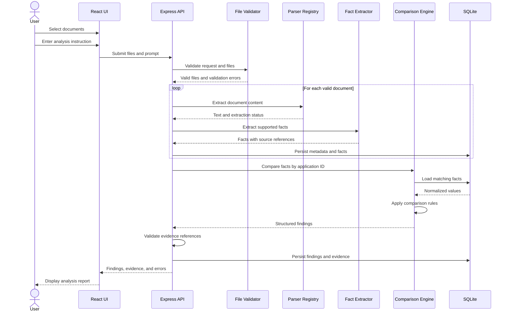

# Low-Level Design (LLD) — BankDoc Intelligence

## 1. Objective

This document describes the request sequence, API contract, core data structures, and comparison logic used by BankDoc Intelligence.

Implementation details should match the source code. Any endpoint or module described here but not yet implemented is a proposed design rather than a completed feature.

## 2. Document Analysis Sequence



## 3. API Contracts

The exact routes depend on the implementation. A suitable API design is:

### Health Check

`GET /api/health`

Example response:

```json
{
  "status": "ok"
}
```

### Analyze Documents

`POST /api/analyses`

Content type: `multipart/form-data`

Suggested inputs:
- `files`: one or more supported documents.
- `prompt`: the user-defined analysis instruction.

Example successful response:

```json
{
  "analysisId": "analysis-example-001",
  "status": "completed",
  "analyzerType": "deterministic-mock",
  "findings": [
    {
      "id": "finding-example-001",
      "applicationId": "APP-0001",
      "type": "discrepancy",
      "category": "income",
      "description": "Declared income differs from certified salary.",
      "valuesCompared": [
        {
          "documentId": "doc-001",
          "fieldName": "declaredMonthlyIncome",
          "value": 75000
        },
        {
          "documentId": "doc-002",
          "fieldName": "certifiedMonthlySalary",
          "value": 70000
        }
      ],
      "evidence": [
        {
          "documentId": "doc-001",
          "documentName": "loan-application.txt",
          "excerpt": "Declared Monthly Income (INR): 75000"
        },
        {
          "documentId": "doc-002",
          "documentName": "salary-certificate.txt",
          "excerpt": "Monthly Gross Salary (INR): 70000"
        }
      ],
      "requiresHumanReview": true
    }
  ],
  "errors": []
}
```

The JSON above is an illustrative contract, not a claim that the running implementation returns these exact fields or values.

## 4. Core TypeScript Models

```typescript
type DocumentStatus =
  | "uploaded"
  | "processing"
  | "processed"
  | "failed";

type FindingType =
  | "extracted_fact"
  | "calculated_value"
  | "discrepancy"
  | "missing_information"
  | "interpretation";

interface DocumentMetadata {
  id: string;
  originalName: string;
  fileType: string;
  fileSize: number;
  status: DocumentStatus;
}

interface EvidenceReference {
  documentId: string;
  documentName: string;
  fieldName?: string;
  excerpt: string;
}

interface ExtractedFact {
  id: string;
  documentId: string;
  applicationId?: string;
  fieldName: string;
  originalValue: string;
  normalizedValue?: string | number;
  valueType: "string" | "number" | "date" | "currency";
  evidence: EvidenceReference;
}

interface Finding {
  id: string;
  applicationId?: string;
  type: FindingType;
  category: string;
  description: string;
  evidence: EvidenceReference[];
  requiresHumanReview: boolean;
}
```

## 5. Document Processing Algorithm

1. Validate the upload request.
2. Reject empty files, unsupported formats, excessive file sizes, and excessive file counts.
3. Assign a stable document ID to each accepted file.
4. Select a parser based on the validated format.
5. Extract text while retaining document identity.
6. Record an explicit error if extraction fails.
7. Extract supported fields from each document independently.
8. Normalize values while preserving original values.
9. Associate facts with application IDs where available.
10. Persist facts and source references.

## 6. Comparison Algorithm

```text
INPUT:
  extracted facts from multiple documents
  user analysis instruction

GROUP:
  facts by application ID

FOR EACH application group:
  compare declared income with certified salary
  calculate account credits and debits from transactions
  compare declared obligations with relevant observed debits
  identify applicant-name variations
  identify required fields that were not extracted

  FOR EACH finding:
    attach the documents used
    attach supporting values and evidence excerpts
    classify the finding
    mark whether human review is needed

  validate every document reference

OUTPUT:
  structured findings
  document-level processing errors
  analysis metadata
```

This is a logical algorithm. The current demo may implement only a subset of these comparisons.

## 7. Example Comparison Rule

```typescript
interface IncomeComparisonInput {
  declaredIncome?: number;
  certifiedSalary?: number;
}

function compareIncome(
  input: IncomeComparisonInput
): {
  differs: boolean;
  difference?: number;
} {
  const { declaredIncome, certifiedSalary } = input;

  if (
    declaredIncome === undefined ||
    certifiedSalary === undefined
  ) {
    return { differs: false };
  }

  return {
    differs: declaredIncome !== certifiedSalary,
    difference: declaredIncome - certifiedSalary
  };
}
```

This example compares two numeric values. Production code should also validate that values are finite, use a defined currency, handle rounding and tolerances, and retain the source references for both values.

## 8. Validation and Error Handling

| Condition | Expected result |
|---|---|
| Unsupported format | File-level validation error |
| Empty file | File-level validation error |
| Oversized file | Rejected before parsing |
| Parser exception | Document marked failed |
| No extracted facts | Explicit no-facts result |
| Missing application ID | Avoid unreliable cross-document matching |
| Missing field | Report not extracted; do not invent a value |
| Invalid evidence ID | Reject or flag the finding |
| Database error | Controlled server error |

## 9. Testing Strategy

Meaningful automated tests should cover:

- Valid and invalid file validation.
- Extraction from each supported format.
- Correct association between facts and document IDs.
- Income discrepancy detection.
- No comparison between unrelated application IDs.
- Findings that cite the correct source documents.
- Handling of a document that cannot be parsed.
- Copying or serializing structured output where applicable.

## 10. Security and Limitations

- Use fictional data only.
- Enforce upload limits on the server.
- Prevent unsafe filenames and path traversal.
- Clean up temporary files.
- Do not log entire banking documents.
- Keep credentials out of source control.
- The mock analyzer does not use a real LLM.
- Results are for document review and must not be treated as verified financial advice or a credit decision.
