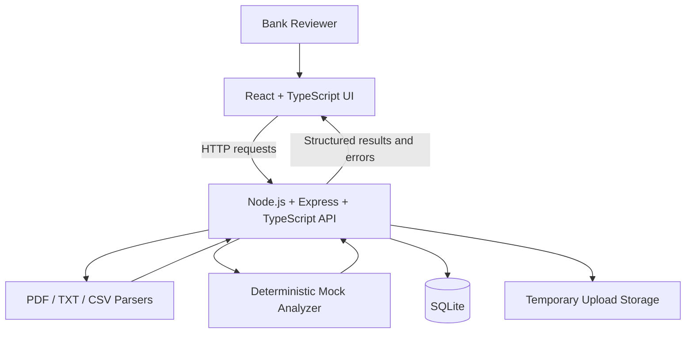
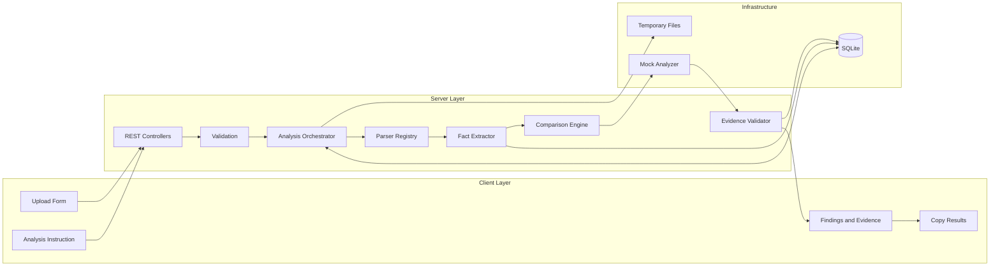

# System Design — BankDoc Intelligence

## 1. Purpose

This document describes the major runtime components and their interactions.

The system accepts multiple synthetic banking documents, extracts content, analyzes the documents independently and collectively, and returns structured findings with source evidence.

## 2. System Context

## 3. Component Responsibilities

### Frontend

- Allow users to select multiple files.
- Accept a user-defined analysis instruction.
- Display upload and processing states.
- Render structured findings and supporting evidence.
- Display validation and processing errors.
- Allow the user to copy generated results.

### Backend API

- Receive and validate requests.
- Enforce upload count, size, and file-format limits.
- Coordinate document processing.
- Return predictable success and error responses.
- Avoid exposing internal errors or server file paths.

### Document Processing

- Select a parser based on the supported format.
- Extract text independently for every document.
- Preserve document IDs and filenames.
- Report parser failures without silently discarding them.

### Fact Extraction and Normalization

- Extract supported banking fields.
- Normalize financial amounts and dates.
- Associate facts with an application ID and source document.
- Preserve original values and evidence excerpts.

### Analysis Engine

- Apply deterministic comparison rules.
- Compare matching application records across documents.
- Generate structured findings.
- Separate extracted facts, calculated values, and interpretations.

### Database

- Persist document metadata, analysis metadata, extracted facts, findings, and evidence references where implemented.
- Maintain stable identifiers and relational integrity.

## 4. Runtime Architecture

## 5. Main Request Flow

1. The frontend submits the selected files and analysis instruction.
2. The backend validates the request and each file.
3. Valid files are passed to their corresponding parsers.
4. Each parser returns extracted content linked to its source document.
5. The fact extractor identifies supported fields.
6. The comparison engine groups facts by application ID.
7. Deterministic rules identify differences and missing extracted values.
8. The evidence validator checks that findings reference known source documents.
9. Results are returned in a structured response.
10. The frontend displays the results and supports copying them.

## 6. Error Handling

| Error | Expected handling |
|---|---|
| Unsupported file type | Reject the file with a clear message |
| Empty file | Report a validation error |
| File exceeds size limit | Reject the file before parsing |
| Unreadable document | Record a document-level processing error |
| No extractable facts | Report that no supported facts were extracted |
| Invalid analysis instruction | Return a validation error |
| Database failure | Return a controlled server error |
| Invalid evidence reference | Reject or flag the invalid finding |

The implementation should continue processing other valid files when a single document fails, where feasible.

## 7. Security Considerations

- Use synthetic data only.
- Enforce file-size and file-count limits on the server.
- Do not trust file extensions alone.
- Generate safe server-side filenames.
- Prevent path traversal and unsafe file access.
- Do not expose secrets or detailed internal errors.
- Restrict upload access in a production environment.
- Clean up temporary files.
- Treat any LLM output as untrusted if a real provider is introduced.

## 8. Scalability and Productionisation

A production version could introduce:

- Object storage for original documents.
- Background jobs for large document processing.
- OCR for scanned documents.
- A real LLM behind a provider abstraction.
- Structured output validation using a schema.
- Authentication, authorization, and tenant isolation.
- Encryption in transit and at rest.
- Monitoring, audit logs, retention controls, and rate limiting.

These are future improvements unless explicitly implemented in the demo.
